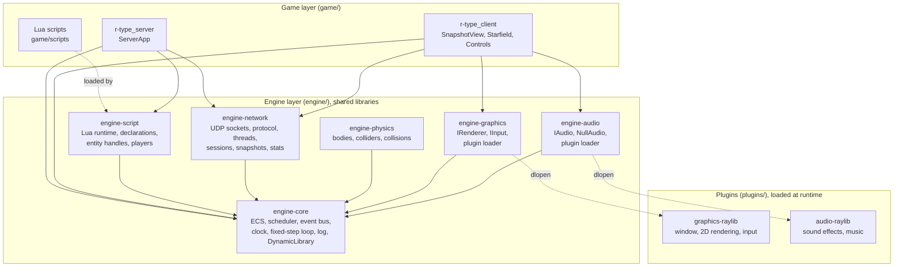
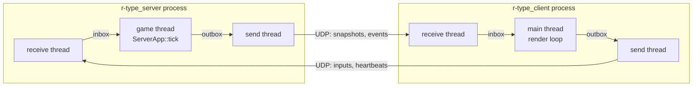
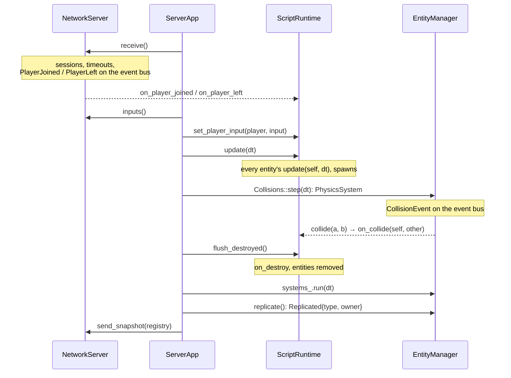

# Architecture

This page gives the big picture: the layers, the subsystems, how data flows
during a tick and a frame, and where each piece lives in the code. Details of
each part are in [Engine modules](engine.md),
[Networking internals](networking.md), [Plugins](plugins.md) and
[Game](game.md).

## Principles

1. **The engine never knows the game.** Nothing under `engine/` names R-Type,
   its entities or its scripts. A feature goes into the engine only if it
   would make sense in another game (a platformer, a Breakout).
2. **The server is authoritative.** Clients send inputs, never positions. The
   server runs every game rule and replicates the result.
3. **Subsystems are decoupled.** Rendering, networking and game logic live in
   separate shared libraries and talk through the ECS and the event bus, never
   by calling each other.
4. **Backends are plugins.** The Raylib backend is loaded at runtime; the
   server never loads it and runs without a display.
5. **Time is fixed-step.** Game logic advances in fixed 1/60 s steps driven by
   the engine clock, never by the frame rate or the CPU speed.

## Layers

| Layer | Knows about | Never knows about |
|---|---|---|
| Game | Public engine headers (`engine/include/`) | Engine internals, Raylib, sockets, Lua C API |
| Engine | Its own modules, third-party libraries privately | The game, the plugins' backend libraries |
| Plugins | Engine interfaces and types | The game |

Third-party headers stay private: `raylib.h` appears only in
`plugins/graphics-raylib/`, POSIX socket headers only in
`engine/src/network/socket/`, Lua and sol2 only in `engine/src/script/`.

## Subsystems

| Subsystem | Module | Main types | Role |
|---|---|---|---|
| ECS | `engine-core` | `EntityManager`, `ComponentPool`, `Entity` | Entities are generational ids; components live in sparse-set pools |
| Systems | `engine-core` | `SystemScheduler` | Runs systems in a fixed order; a throwing system is disabled and logged |
| Events | `engine-core` | `EventBus`, `Subscription` | Typed publish/subscribe between subsystems |
| Time | `engine-core` | `IClock`, `SteadyClock`, `ManualClock`, `FixedStepLoop` | Fixed-step simulation, injectable clock for tests |
| Logging | `engine-core` | `log::info/warn/error`, `Sink`, `MemorySink` | Levelled logs on stderr; tests capture them |
| Scripting | `engine-script` | `ScriptRuntime` | Loads and sandboxes Lua, spawns scripted entities, runs callbacks |
| Networking | `engine-network` | `NetworkServer`, `NetworkClient` | UDP transport, protocol, sessions, replication |
| Physics | `engine-physics` | `PhysicsSystem`, `PhysicsBody`, `AABBCollider` | Integration and collision detection/resolution; the server uses it to find hitbox overlaps |
| Rendering and input | `engine-graphics` + plugin | `IRenderer`, `IInput`, `load_graphics_plugin` | Backend-independent drawing and keyboard/mouse input |

## Executables

Both processes use the same `NetworkIo` core: one thread reads the socket, one
thread writes to it, and the game or render thread only touches two queues.
See [Networking internals](networking.md).

### One server tick (60 Hz)

`ServerApp::tick` in `game/server/ServerApp.cpp`:

### One client frame

`game/client/main.cpp`:

1. `network.update()`: apply received snapshots and events, retry the
   connection, send heartbeats, detect a silent server.
2. Read the keyboard through `IInput` and turn it into actions
   (`Controls.cpp`).
3. In fixed 1/60 s steps: scroll the starfield and send the input to the
   server.
4. Draw the starfield, then every replicated entity with
   `assets/sprites/<type>.png` tinted with its colour, then the marker above
   the local player's ship.

The client never runs game rules: it draws what the server sent.

## Data ownership

| Data | Owner | Who reads it |
|---|---|---|
| World state (entities, components) | Server game thread | Snapshot builder, on the same thread |
| Lua state | Server game thread | Nobody else: Lua is single-threaded |
| Sessions, sequences, statistics | Game thread (server) / main thread (client) | Same thread only, no lock |
| Inbox / outbox | `MessageQueue`, mutex-protected | Receive thread pushes, game thread drains; game thread pushes, send thread drains |
| Socket | `NetworkIo` | Receive thread reads, send thread writes |
| Window, textures, input | Client main thread | Graphics calls happen only there |

## Code map

| Concern | Where |
|---|---|
| Public engine API | `engine/include/engine/<module>/` |
| Engine implementation | `engine/src/<module>/` |
| CMake helpers (`engine_add_module`, `engine_add_plugin`) | `engine/cmake/EngineModule.cmake` |
| Raylib backends | `plugins/graphics-raylib/src/`, `plugins/audio-raylib/src/` |
| Server wiring | `game/server/` (`main.cpp`, `ServerApp`, `Cli`) |
| Client wiring | `game/client/` (`main.cpp`, `SnapshotView`, `Starfield`, `Controls`, `AudioPlayer`, `Cli`) |
| Input encoding shared by both | `game/common/ActionCodec` |
| Game rules | `game/scripts/` |
| Tests | `tests/engine/<module>/`, `tests/game/<target>/`, `tests/plugins/<name>/` |

## Where this is going (Part 2)

The `main` functions become generic `ServerApp` / `ClientApp` classes in the
engine, the engine moves to its own repository consumed through vcpkg, and a
second game written only in Lua proves it is generic. See the
[roadmap](PROJECT.md#15-roadmap).
