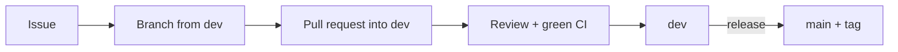

# Contributing

How we work together. The full code rules are in
[AGENTS.md](https://github.com/Saitamadupauvre/RType/blob/dev/AGENTS.md); this
page is the short version.

## Workflow



1. Open (or pick) an issue on the GitHub project board.
2. Create a branch from `dev` named after it (`feat/...`, `fix/...`,
   `docs/...`).
3. Commit in [Conventional Commits](https://www.conventionalcommits.org/)
   style, one logical change per commit: `feat:`, `fix:`, `test:`, `docs:`,
   `build:`, `ci:`, `refactor:`.
4. Open a pull request into `dev` with `Closes #<issue>` and fill in the
   template.
5. CI must be green (Linux GCC, Linux Clang, macOS, ASan, TSan, clang-tidy,
   format) and a teammate reviews it (`.github/CODEOWNERS` requests the reviewers).
6. `dev` is merged into `main` for releases, and each release is tagged
   (`v1.0` for Part 1).

## Golden rules

1. **Every feature and every bug fix comes with GoogleTest tests.** A bug fix
   starts with a test that reproduces it.
2. **The engine never knows about the game.** Nothing under `engine/`
   includes, links or names anything from `game/`.
3. **The engine stays extractable.** It uses only its own CMake helpers; the
   game links only `engine::*` targets.
4. **Dependencies only through vcpkg.** No copied sources, no `FetchContent`,
   no submodules.
5. **CI must be green** before merging.

## Code style

- C++20, formatted by clang-format 23.1.1 (`.clang-format`), checked by
  clang-tidy (`.clang-tidy`).
- `snake_case` functions and variables, `PascalCase` types and files,
  namespaces `engine::<module>`, private members prefixed with `_`.
- **No comments** in code, CMake or CI files. The only exception is Doxygen
  on the public API (`engine/include/`) and plugin interfaces: `/** @brief ...
  */` documenting the contract.
- Third-party headers never appear in public engine headers.

## Tests

- Tests mirror the code: `engine/src/<module>/Foo.cpp` →
  `tests/engine/<module>/FooTest.cpp`, registered with
  `engine_add_test(<module> SOURCES ...)`.
- Names: `TEST(Feature, ExpectedBehaviour)`.
- Test the failure paths: truncated packets, Lua errors, missing plugin...
- Deterministic: no real network beyond loopback, no sleeps, no display.
  Inject the clock and random seeds. Test data goes in `tests/fixtures/`.

## Documentation

- Documentation is in English, in `docs/`, and is updated in the same pull
  request as the code it describes.
- Changes to the Lua API update [PROJECT.md §10](PROJECT.md#10-lua-scripting-api).
- Changes to the protocol update [protocol.md](protocol.md) and the protocol
  version.
- New pages are added to the `nav` of `mkdocs.yml`; check them with
  `mkdocs build` (strict mode fails on broken links).

## clang-tidy exceptions

`NOLINT` markers are comments, which the rules forbid: fix the code, or
disable the check project-wide in `.clang-tidy` and document why here.

| Disabled check | Reason |
|---|---|
| `clang-analyzer-optin.core.EnumCastOutOfRange` | Decoders turn untrusted bytes into enums and must reject out-of-range values; their tests have to cast such values (e.g. `static_cast<DisconnectReason>(9)`) to prove it. |

## Before pushing

```sh
./fred.sh all
```

Runs the format check, the debug build, the tests and clang-tidy. See
[Commands](commands.md) for each step.
