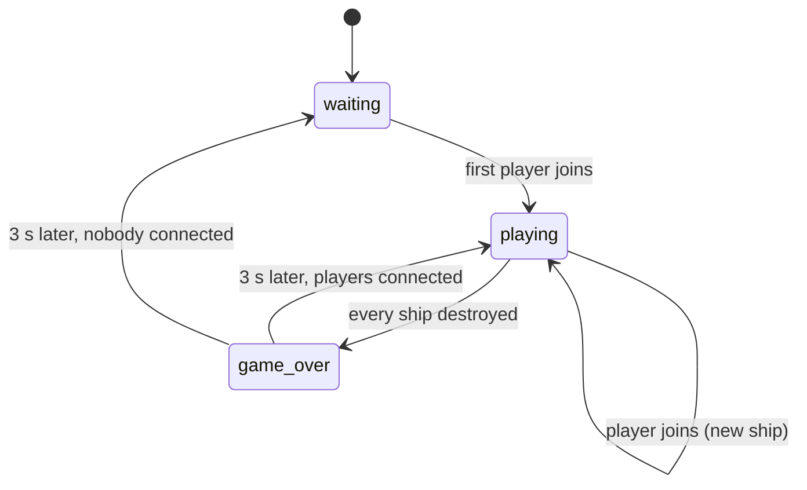

# R-Type example

`examples/r-type/` is a complete networked shoot'em up made with the engine,
after the classic R-Type: up to four players fight waves of Bydos together.
It is a plain game folder, with no C++ of its own, and the reference for how
a full game is organised.

```sh
editor examples/r-type                                     # open it in the editor
engine-runtime --game examples/r-type --solo               # play alone
engine-runtime --game examples/r-type --host 4242          # host a game
engine-runtime --game examples/r-type 127.0.0.1 4242       # join it
engine-runtime --game examples/r-type --server 4242        # dedicated server
```

## How to play

Survive the Bydos coming from the right of the screen and shoot as many as you
can, together with up to three other players.

| Action | Keys |
|---|---|
| Move up / down / left / right | Arrow keys, or `Z` / `S` / `Q` / `D` |
| Fire | `Space`, hold it to keep firing (4 missiles per second) |
| Mute / unmute every sound | `M` |
| Metrics overlay | `F3` |
| Developer console | `` ` `` or `F1` |
| Quit | Close the window |

Both key sets work at the same time, so you can play with either hand.

- The game starts as soon as the first player connects. A player who joins a
  running game gets a ship immediately.
- Each ship starts on the left side, on its own row, in its player's color:
  blue, red, green, then yellow, by join order. A slot freed by a player who
  leaves goes to the next one who joins.
- Bydos spawn at random heights on the right edge, one every 1.5 seconds,
  and fly to the left. Each Bydo fires a shot straight ahead 0.8 seconds after
  appearing, then every 2.5 seconds.
- A missile that hits a Bydo destroys both. Missiles and Bydo shots pass
  through each other.
- A Bydo or a Bydo shot that touches a ship destroys it. A destroyed player
  watches until the next round.
- When every ship is destroyed, the game is over. A new round starts 3
  seconds later with a ship for every connected player.
- If a player quits or their client crashes, their ship disappears for
  everyone (within 5 seconds for a crash).

A looping music plays during the game, and each shot and explosion has its
own sound. Every sound has a visual counterpart, so the game can be played
without sound. Volumes are set with `--music-volume`, `--effects-volume` and
`--mute` (see [Run and export](../guide/run-and-export.md#command-line)).

## The folder

```
examples/r-type/
├── game.json             name "R-Type", start scene stage1
├── scenes/stage1.json    the background (space) and the game controller (game)
├── assets/               sprites, sounds, music, the background shader; credits in CREDITS.md
└── scripts/
    ├── main.lua              server: music, players joining and leaving; client: mute on M
    ├── game.lua              entity "game": rounds, ships, game over, restart
    ├── player/ship.lua       entity "ship": movement, shooting
    ├── player/missile.lua    entity "missile"
    ├── enemies/bydo.lua      entity "bydo": flies left, shoots after 0.8 s then every 2.5 s
    ├── enemies/bydo_shot.lua entity "bydo_shot": flies left, destroys the ship it hits
    ├── enemies/spawner.lua   entity "bydo_spawner": one Bydo every 1.5 s at a random height
    ├── world/space.lua       entity "space": the background, drawn through shaders/space
    └── lib/                  config.lua (every tunable value), roster.lua (groups), controls.lua (key bindings)
```

Opened in the editor, the scene `stage1` shows two instances: `background`
(a `space`) and `controller` (a `game`, drawn as a crossed outline since the
game does not draw it). Everything else is spawned by scripts while playing.

## How it is built

**Game flow.** The `game` entity, placed in the scene and declared
`persistent = true`, runs the rounds; `main.lua` forwards players joining and
leaving to it.



**Collisions** are declared per entity with `hitbox` and `collides_with`; the
engine calls `on_collide` on the side that asked for it:

| Entity | Tags | `collides_with` | On collision |
|---|---|---|---|
| `ship` | `player`, `ship` | `enemy`, `enemy_shot` | explodes |
| `missile` | `missile` | `enemy` | disappears |
| `bydo` | `enemy` | `missile` | explodes |
| `bydo_shot` | `enemy_shot` | `player` | disappears |

**Background.** `space` is a black 64 px square scaled to the whole screen
with `z_index = -100`, drawn through `assets/shaders/space.fs`: a fragment
shader painting a drifting nebula and three parallax layers of twinkling
stars scrolling with `time`.

**Stand-ins.** R-Type uses the patterns of
[What is not there yet](../guide/scripting.md#what-is-not-there-yet):
`lib/roster.lua` groups instead of `find_all`, the `game` and `bydo_spawner`
entities instead of systems, time counters instead of `every`.

## Tune it

Every number is in `scripts/lib/config.lua`:

| Want | Change |
|---|---|
| Faster ships | `ship.speed` |
| Shoot more often | `ship.fire_cooldown` (seconds between missiles) |
| More enemies | `bydo.spawn_interval` (seconds between spawns) |
| Faster enemies | `bydo.speed` |
| Enemies shoot more often | `bydo.fire_interval`, `bydo.first_shot_delay` |
| Faster enemy shots | `bydo_shot.speed` |
| Longer pause after game over | `game.restart_delay` |
| Other player colors | `ship.colors` (one per slot) |

Save, press Play in the editor: no rebuild.

## Add an enemy

Goal: a "zigzag" enemy that flies left along a sine wave and takes two hits.

**1. Its sprite**, e.g. `assets/sprites/zigzag.png`. Without the file, the
game draws a placeholder.

**2. Its tunables**, in `scripts/lib/config.lua`:

```lua
zigzag = { hitbox = { w = 64, h = 64 }, speed = 250, amplitude = 120, frequency = 3, health = 2 },
```

**3. Its declaration**, `scripts/enemies/zigzag.lua`:

```lua
local config = require("config")
local roster = require("roster")

entity "zigzag"

tags          = { "enemy" }
sprite        = "sprites/zigzag.png"
speed         = config.zigzag.speed
hitbox        = config.zigzag.hitbox
collides_with = { "missile" }
health        = config.zigzag.health

function on_spawn(self)
    self.base_y = self.y
    roster.add(self, "enemies")
end

function on_destroy(self)
    roster.remove(self)
end

function on_collide(self, other)
    self.health = self.health - 1
    if self.health <= 0 then
        roster.destroy(self)
    end
end

function update(self, dt)
    local zigzag = config.zigzag
    self.x = self.x - self.speed * dt
    self.y = self.base_y + math.sin(self.age * zigzag.frequency) * zigzag.amplitude
    if self.x <= -self.hitbox.w then
        roster.destroy(self)
    end
end
```

The `enemy` tag is all it takes for missiles and ships to hit it. Joining the
`enemies` group lets the game clear it on restart. `health` is a script
field: place a zigzag in `stage1` with the editor and give that one
`health = 10`.

**4. Spawn it** from `enemies/spawner.lua`, from time to time:

```lua
local kind = math.random() < 0.25 and "zigzag" or "bydo"
spawn(kind, { x = config.world.width, y = math.random(0, config.world.height - config.bydo.hitbox.h) })
```

**5. Play.** No C++, no new network message: the new type is sent to clients
when they connect.

## Add a sound

1. Put the file in `assets/sounds/` (effects) or `assets/music/` (music), with
   a plain name: letters, digits, `_`, `-`, `.`. Credit it in
   `assets/CREDITS.md`.
2. Declare it in `main.lua`, next to the others:
   ```lua
   sounds { "laser_shoot.wav", "explosion.wav", "power_up.wav" }
   ```
3. Play it from any server script: `play("power_up.wav", self)`. Every client
   plays the file of the same name. `music("bit_space.mp3")` loops a music,
   `music(nil)` stops it.

## Credits

The music is by Beam Theory (OGA-BY 3.0). The ship, missile and Bydo sprites
come with the Epitech R-Type subject and are used for educational purposes
only; R-Type is a trademark of its owners. Every asset is credited in
`examples/r-type/assets/CREDITS.md`.
