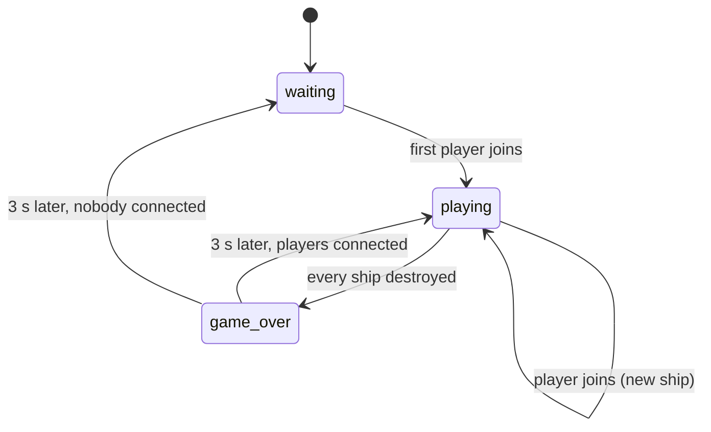

# Game

The game lives in `game/`. It is R-Type, built on top of the engine: two thin
C++ executables, and the game itself, written in Lua.

```
game/
├── server/       r-type_server: Cli, main.cpp (dedicated server)
├── client/       r-type_client: Cli, main.cpp (client, host, solo)
├── sandbox/      r-type_sandbox: scratch executable to try the engine out (option `RTYPE_BUILD_SANDBOX`, on by default)
└── scripts/      the Lua game, main.lua is the entry point
```

## The contract

The game is a **user** of the engine, exactly like a second game would be.

- It links only `engine::*` targets and includes only public engine headers
  (`#include "engine/<module>/..."`), never `engine/src/`.
- It never links a plugin: the client loads `graphics-raylib` at runtime.
- It never uses Lua, Raylib or the socket API directly: they are reached only
  through the engine.
- Gameplay rules live in Lua, and so do the client hotkeys (`M` mutes). The
  C++ in `game/` is only the command line and the choice of mode: the loops,
  the drawing and the audio are the engine's generic `ServerApp` and
  `ClientApp` (`engine-app`).

In the other direction, nothing under `engine/` names R-Type, its entities or
its scripts.

## Targets

Code under test lives in static libraries linked by the executables, so the
tests in `tests/game/` link the same code.

| Target | Kind | Sources | Links |
|---|---|---|---|
| `r-type_server_cli` | static | `server/Cli.cpp` | clap |
| `r-type_server` | executable | `server/main.cpp` | `r-type_server_cli`, `engine::app` |
| `r-type_client_cli` | static | `client/Cli.cpp` | clap, `engine::app` (for `Mode`) |
| `r-type_client` | executable | `client/main.cpp` | `r-type_client_cli`, `engine::app`; builds `graphics-raylib` and `audio-raylib` with it |

## Executables

| Executable | Usage | Role |
|---|---|---|
| `r-type_server` | `r-type_server <port> [--max-players <1-4>]` | Dedicated server: runs the Lua game at 60 Hz, sends snapshots |
| `r-type_client` | `r-type_client <server-ip> <port>` | Joins a server, sends inputs, draws what it replicates |
| `r-type_client` | `r-type_client --host <port>` | Hosts a game others can join (server on a background thread) and plays on it |
| `r-type_client` | `r-type_client --solo` | Plays alone, server and client in one thread, no socket |

Both exit with code `84` on invalid arguments or when the game cannot start;
see the [README](https://github.com/Saitamadupauvre/RType#launch-the-game) for
every error case.

Each `main.cpp` parses its command line into `engine::app::LaunchOptions`
(mode, the folder of the executable as game folder, plugin files, port,
window, audio levels) and calls `engine::app::launch()` until SIGINT or
SIGTERM, or until the window closes. Everything else is the engine:

- `ServerApp` loads the scripts with the server API, builds the string table,
  forwards `PlayerJoined` / `PlayerLeft` to Lua and runs the tick (see
  [PROJECT §6](PROJECT.md#6-executables)). Every scripted entity with a
  `sprite` or a `color` is replicated; entities with neither (`game`,
  `bydo_spawner`) stay on the server.
- `ClientApp` loads the same scripts with the client API, draws each
  received entity with `assets/sprites/<type>.png` tinted with its colour
  (unknown sprite → coloured square), plays the sounds and music the server
  asks for, and runs the `client = { ... }` code of `main.lua` every tick.

Because the client looks sprites up by type name, **the sprite of a
replicated entity type must be named `assets/sprites/<type>.png`**.

## Scripts

```
game/scripts/
├── main.lua              server: on_start, on_player_joined, on_player_left; client: mute on M
├── game.lua              entity "game": rounds, ships, game over, restart
├── player/ship.lua       entity "ship": movement, shooting
├── player/missile.lua    entity "missile"
├── enemies/bydo.lua      entity "bydo": flies left, shoots after 0.8 s then every 2.5 s
├── enemies/bydo_shot.lua entity "bydo_shot": flies left, destroys the ship it hits
├── enemies/spawner.lua   entity "bydo_spawner": one Bydo every 1.5 s at a random height
└── lib/                  config.lua (every tunable value), roster.lua (groups), controls.lua (key bindings)
```

- Every `.lua` file under `scripts/` is loaded, except `lib/`, reached with
  `require`.
- Each file declares what it contains: `entity "name"` or `system "name"`.
- `main.lua` holds a `server = { ... }` table (`on_start()`, called once every
  declaration is loaded, and the player callbacks) and a `client = { ... }`
  table (`update(dt)`, toggling the sound with `M`).
- Game logic runs on the server only.

Game flow:



Collisions are declared per entity type with `hitbox` and `collides_with`;
the engine calls `on_collide` on the side that asked for it:

| Entity | Tags | `collides_with` | On collision |
|---|---|---|---|
| `ship` | `player`, `ship` | `enemy`, `enemy_shot` | explodes |
| `missile` | `missile` | `enemy` | disappears |
| `bydo` | `enemy` | `missile` | explodes |
| `bydo_shot` | `enemy_shot` | `player` | disappears |

Tunable values (speeds, hitboxes, spawn interval, fire cooldowns, colours,
restart delay) are all in `lib/config.lua`.

The Lua API is in [PROJECT.md §10](PROJECT.md#10-lua-scripting-api); how to
add content is in [Writing the game](writing-the-game.md).

## Runtime layout

Executables find everything relative to their own location, never the working
directory. The build copies `scripts/` and `assets/` next to them:

```
bin/
├── r-type_server
├── r-type_client
├── libengine-{core,graphics,network,physics,script}.so
├── plugins/graphics-raylib.so
├── scripts/
└── assets/sprites/{ship,missile,bydo}.png
```

On Linux the RPATH `$ORIGIN` finds the engine libraries, and the plugin's
RPATH `$ORIGIN/..` finds them from `plugins/`.

## Rules

- If a feature would make sense in another game, it belongs in the engine,
  exposed to Lua; otherwise it belongs in the scripts.
- The C++ in `game/` stays minimal: wiring only, no gameplay.
