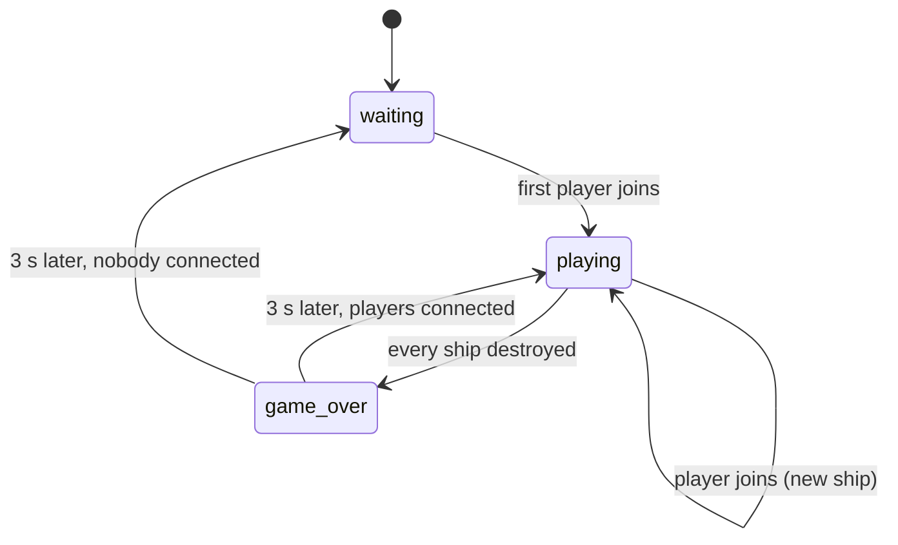

# Game

The game lives in `game/`. It is R-Type, built on top of the engine: two thin
C++ executables, and the game itself, written in Lua.

```
game/
├── server/       r-type_server: Cli, ServerApp, main.cpp
├── client/       r-type_client: Cli, Controls, SnapshotView, WorldDraw, Starfield, main.cpp
├── common/       ActionCodec: input encoding shared by both
├── sandbox/      r-type_sandbox: scratch executable to try the engine out (option `RTYPE_BUILD_SANDBOX`, on by default)
└── scripts/      the Lua game, main.lua is the entry point
```

## The contract

The game is a **user** of the engine, exactly like a second game would be.

- It links only `engine::*` targets and includes only public engine headers
  (`#include "engine/<module>/..."`), never `engine/src/`.
- It never links a plugin: the client loads `graphics-raylib` at runtime.
- It never uses Lua, Raylib or the socket API directly: they are reached only
  through the engine.
- Gameplay rules live in Lua. The C++ in `game/` is wiring: command line,
  loops, drawing what the server sent.

In the other direction, nothing under `engine/` names R-Type, its entities or
its scripts.

## Targets

Code under test lives in static libraries linked by the executables, so the
tests in `tests/game/` link the same code.

| Target | Kind | Sources | Links |
|---|---|---|---|
| `r-type_server_cli` | static | `server/Cli.cpp` | clap |
| `r-type_server_app` | static | `server/ServerApp.cpp` | core, script, network, `r-type_common` |
| `r-type_server` | executable | `server/main.cpp` | `r-type_server_app` |
| `r-type_common` | static | `common/ActionCodec.cpp` | script |
| `r-type_client_cli` | static | `client/Cli.cpp` | clap |
| `r-type_client_controls` | static | `client/Controls.cpp` | graphics, script |
| `r-type_client_draw` | static | `client/Starfield.cpp`, `WorldDraw.cpp`, `SnapshotView.cpp` | core, graphics, network |
| `r-type_client` | executable | `client/main.cpp` | the client libraries; builds `graphics-raylib` with it |

## Executables

| Executable | Usage | Role |
|---|---|---|
| `r-type_server` | `r-type_server <port> [--max-players <1-4>]` | Authoritative: runs the Lua game at 60 Hz, sends snapshots |
| `r-type_client` | `r-type_client <server-ip> <port>` | Sends inputs, draws what the server replicates |

Both exit with code `84` on invalid arguments; see the
[README](https://github.com/Saitamadupauvre/RType#launch-the-game) for every
error case.

### Server

`main.cpp` parses the command line, builds a `ServerApp` with the
`scripts/` folder next to the executable, starts it (exit `84` if the port
cannot be bound) and runs it until SIGINT or SIGTERM.

`ServerApp` holds no game rule:

- loads the scripts and builds the string table sent to clients from the Lua
  declarations: entity types, sounds and musics, each numbered from 1 in
  declaration order;
- forwards `PlayerJoined` / `PlayerLeft` from the network to Lua
  `on_player_joined` / `on_player_left`;
- each tick: receive, apply each player's input, `update` the scripts,
  detect hitbox overlaps with `engine-physics` and call Lua `on_collide`
  (`Collisions.cpp`), destroy marked entities, run systems, mark every scripted entity with a
  `sprite` or a `color` as `Replicated { type_id, owner }`, send the snapshot.

Entities with neither (`game`, `bydo_spawner`) stay on the
server.

### Client

`main.cpp` loads the graphics plugin from `plugins/`, connects, opens a
1280 × 720 window and loops: update the network, read the controls, send the
input and scroll the starfield in fixed steps, draw.

| File | Role |
|---|---|
| `Controls.cpp` | Keys → actions: arrows or `ZQSD` give `move_x` / `move_y`, `Space` gives `fire` |
| `common/ActionCodec.cpp` | Actions → protocol input (`fire` is bit 0, axes rounded to -1/0/1) and back on the server |
| `Starfield.cpp` | Three parallax layers of stars scrolling at 40, 100 and 220 units/s, seeded so it looks the same every run |
| `SnapshotView.cpp` | Mirrors the received entities into a local ECS and draws each with `assets/sprites/<type>.png` tinted with its colour; unknown sprite → coloured square; a white dot marks the local player's entities |
| `WorldDraw.cpp` | Draws every `Position` + `Sprite`, caching textures by path |

Because the client looks sprites up by type name, **the sprite of a
replicated entity type must be named `assets/sprites/<type>.png`**.

## Scripts

```
game/scripts/
├── main.lua              on_start, on_player_joined, on_player_left
├── game.lua              entity "game": rounds, ships, game over, restart
├── player/ship.lua       entity "ship": movement, shooting
├── player/missile.lua    entity "missile"
├── enemies/bydo.lua      entity "bydo": flies left, shoots after 0.8 s then every 2.5 s
├── enemies/bydo_shot.lua entity "bydo_shot": flies left, destroys the ship it hits
├── enemies/spawner.lua   entity "bydo_spawner": one Bydo every 1.5 s at a random height
└── lib/                  config.lua (every tunable value), roster.lua (groups)
```

- Every `.lua` file under `scripts/` is loaded, except `lib/`, reached with
  `require`.
- Each file declares what it contains: `entity "name"` or `system "name"`.
- `main.lua` defines `on_start()`, called once every declaration is loaded.
- Logic runs on the server only.

Game flow:



Collisions are declared per entity type with `hitbox` and `collides_with`;
the engine calls `on_collide` on the side that asked for it:

| Entity | Tags | `collides_with` | On collision |
|---|---|---|---|
| `ship` | `player`, `ship` | `enemy`, `enemy_shot` | explodes |
| `missile` | `missile` | `enemy` | disappears |
| `bydo` | `enemy` | `missile` | explodes |
| `bydo_shot` | `enemy_shot` | `player` | disappears |

Tunable values (speeds, hitboxes, spawn interval, fire cooldowns, colours,
restart delay) are all in `lib/config.lua`.

The Lua API is in [PROJECT.md §10](PROJECT.md#10-lua-scripting-api); how to
add content is in [Writing the game](writing-the-game.md).

## Runtime layout

Executables find everything relative to their own location, never the working
directory. The build copies `scripts/` and `assets/` next to them:

```
bin/
├── r-type_server
├── r-type_client
├── libengine-{core,graphics,network,physics,script}.so
├── plugins/graphics-raylib.so
├── scripts/
└── assets/sprites/{ship,missile,bydo}.png
```

On Linux the RPATH `$ORIGIN` finds the engine libraries, and the plugin's
RPATH `$ORIGIN/..` finds them from `plugins/`.

## Rules

- If a feature would make sense in another game, it belongs in the engine,
  exposed to Lua; otherwise it belongs in the scripts.
- The C++ in `game/` stays minimal: wiring only, no gameplay.
