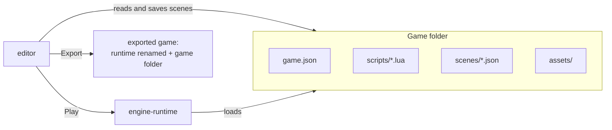

# Making games

This guide is for people who make games with the engine. It needs no C++: a
game is a folder of Lua scripts, JSON scenes and assets, laid out in the editor
and run by the runtime.

## The three pieces

| Piece | What it is | You use it to |
|---|---|---|
| **Game folder** | `game.json`, `scripts/`, `scenes/`, `assets/` | Hold the whole game. It is the only thing you write. |
| **Editor** (`editor`) | A desktop app | Place entities in scenes, tune their fields, play, export |
| **Runtime** (`engine-runtime`) | The engine's player | Run a game: solo, hosted, joined, or as a dedicated server |

Nothing is compiled when you make a game. The runtime reads the scripts with
its Lua interpreter, the scenes and `game.json` as JSON, and the assets as
files, every time it starts. Changing a script and pressing Play is enough to
see the change.

## Who does what

| Task | Where |
|---|---|
| Declare entity types (prefabs): their look, hitbox, behaviour | Lua scripts, in your text editor |
| Global rules: players joining, scores, switching scenes | `scripts/main.lua` |
| Place entities in a level, change a field of one of them | The editor's viewport and inspector |
| Try the game | The editor's **Play** button |
| Ship the game | The editor's **Export** dialog |
| Play with friends over the network | The runtime or the exported game, in `--host` / join mode |

The editor never edits code: **Open script** in the inspector opens the file
in your system's program for `.lua` files.

## Read in this order

1. [Getting started](../getting-started.md): build the editor and the runtime, open the example.
2. [The editor](editor-tour.md): every panel, tool and shortcut.
3. [Your first game](first-game.md): a small game from an empty folder to an exported build.
4. [Game folders and scenes](game-folder.md): the files the editor and the runtime read.
5. [Scripting a game](scripting.md): how to organise gameplay in Lua.
6. [Play and debug](play-and-debug.md): Play, the console, metrics, errors.
7. [Run and export](run-and-export.md): the runtime's modes and shipping a game.

The [Lua API reference](../reference/lua-api.md) lists every function, and
the [R-Type example](../examples/r-type.md) shows a complete game.
