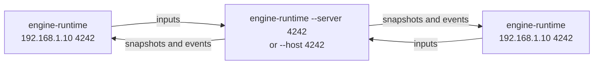

# Run and export

A game folder is played by **`engine-runtime`**, the engine's player. It is
the program the editor's Play starts, and the program an export ships under
the game's name.

## Modes

| Mode | Command | Server | Window |
|---|---|---|---|
| Solo | `engine-runtime --game <folder> --solo` | In the same process, no socket | Yes |
| Host | `engine-runtime --game <folder> --host <port>` | On a background thread; others can join | Yes |
| Join | `engine-runtime --game <folder> <server-ip> <port>` | Elsewhere | Yes |
| Dedicated server | `engine-runtime --game <folder> --server <port>` | On the main thread | No |



Every client needs the same game folder as the server: the server sends
entities, sounds and events by name, and each client loads its own copy of
the scripts and assets.

## Command line

```
engine-runtime [options] <server-ip> <port>
engine-runtime [options] --host <port>
engine-runtime [options] --server <port>
engine-runtime [options] --solo
```

| Option | Meaning |
|---|---|
| `server-ip`, `port` | Server to join: an IPv4 address or host name, and its UDP port (1 to 65535) |
| `--host <port>` | Host a game on this UDP port and play on it |
| `--server <port>` | Run a dedicated server on this UDP port, without a window |
| `--solo` | Play alone, without any network |
| `--game <folder>` | Game folder to run. Without it, the folder of the program itself, which is how an exported game runs |
| `--scene-file <file>` | Start from this scene file instead of the `start_scene` of `game.json` (what the editor's Play uses) |
| `-p`, `--max-players <1..4>` | Maximum connected players when hosting or serving; 4 by default |
| `--music-volume <0..100>` | Music volume; 100 by default |
| `--effects-volume <0..100>` | Sound effects volume; 100 by default |
| `--mute` | Start with every sound muted |
| `-h`, `--help` | Print the usage and exit with `0` |

Exactly one mode must be given. When `game.json` lists `modes`, any other
mode is refused with exit code `84`, naming the modes the game offers:

```
$ ./space-game --server 4242
Space Game does not offer the dedicated mode; it offers: solo, host, client
```

The window title is the `name` of `game.json`, or the folder's name.

## Exit codes and errors

| Situation | Behaviour |
|---|---|
| Missing or invalid argument, or several modes | Prints the error and the usage, exits with `84` |
| A mode the game's `modes` does not list | Prints the modes it offers, exits with `84` |
| The server cannot listen on the port (already in use...) | Exits with `84` |
| `plugins/graphics-raylib` cannot be loaded or the window cannot open | Exits with `84` |
| `plugins/audio-raylib` cannot be loaded, or no audio device | Warning; plays without sound |
| Server full (`--max-players` reached) | The client is refused and stays on an empty screen |
| Server stops or stops answering | The client stops receiving updates after 5 seconds |
| A client crashes or disconnects | Dropped after 5 seconds, other players notified |
| `Ctrl+C` / SIGTERM | Notifies every client, exits with `0` |

The runtime finds its libraries and plugins **next to itself**, so it can be
started from any directory. Move the whole folder, never the program alone.

## Playing over a local network

1. On the host, find its IPv4 address (`ip addr` on Linux,
   `ipconfig getifaddr en0` on macOS).
2. Start `--host <port>` (to play too) or `--server <port>` (headless).
3. Allow incoming **UDP** traffic on that port in its firewall.
4. Each other player runs `<host-ip> <port>` with the same game.

## Exporting from the editor

**Export** in the menu bar (or File > Export game...) opens a dialog:

| Setting | Default |
|---|---|
| Name | `name` of `game.json` as a file name (`Space Game` gives `space-game`), or the folder name |
| Output folder | `<name>-export` next to the game folder |
| Modes | **Solo**, **Host**, **Join** and **Server** toggles: the `modes` of `game.json`, or all four |

The modes decide what players can do with the exported game:

| Mode | Lets players | Exported as |
|---|---|---|
| Solo | Play alone | `./<name> --solo` |
| Host | Host a game and play on it | `./<name> --host <port>` |
| Join | Join a server | `./<name> <server-ip> <port>` |
| Server | Run a dedicated server | `./<name>-server <port>`, a launcher for `./<name> --server <port>` |

A client-only export is Server off: no `<name>-server`, and the runtime refuses
`--server`. A solo game is only Solo on. The chosen modes are written into the
exported `game.json` (never into your game folder), and `README.txt` only
lists them.

The export copies, without building anything:

```
<name>-export/
├── <name>                 engine-runtime, renamed
├── <name>-server          dedicated server launcher, with Server on
├── libengine-*.so         engine libraries
├── plugins/               graphics and audio backends
├── game.json              with the chosen modes
├── scripts/
├── scenes/                when the game has some
├── assets/                when the game has some
└── README.txt             how to run each offered mode
```

The exported programs use their own folder as the game folder:

```sh
./space-game --solo
./space-game --host 4242
./space-game 192.168.1.10 4242
./space-game-server 4242 --max-players 2
```

The dialog lists what it will copy, or each problem that blocks the export:

- a name that is not 1 to 63 letters, digits, `_` or `-`;
- no mode chosen;
- no output folder, an output folder inside the game folder, or one that
  exists and is not empty;
- a missing `engine-runtime`, `plugins/` or `scripts/`.

Export stays disabled until there are none, and it never overwrites anything.
The exported folder can be moved or zipped as it is. It runs on the same
system the editor was built for (Linux or macOS).

## Without the editor

Exporting is only copying, so it can be scripted: copy `engine-runtime`
(renamed), the `libengine-*` libraries and `plugins/` from the build's `bin/`
folder, then `game.json`, `scripts/`, `scenes/` and `assets/` from the game
folder, all into one folder. Add `"modes"` to the copied `game.json` to limit
what it offers, and, for a dedicated server launcher, a `<name>-server` script:

```sh
#!/bin/sh
exec "$(dirname "$0")/<name>" --server "$@"
```
