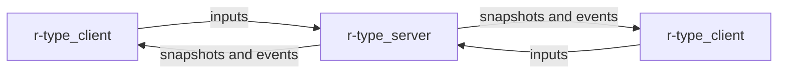

# R-Type

A networked multiplayer remake of the horizontal shoot'em up **R-Type**, built
on our own reusable C++20 game engine. Up to four players connect to an
authoritative server over UDP and fight waves of Bydos together. The game
itself is written in Lua: the engine knows nothing about R-Type.



## Where to start

| I want to... | Read |
|---|---|
| Build and launch the game | [Getting started](getting-started.md) |
| Know the controls and rules | [How to play](how-to-play.md) |
| Understand how the code is organised | [Architecture](architecture.md) |
| Add an enemy, a weapon, a rule | [Writing the game](writing-the-game.md) and the [Lua API](PROJECT.md#10-lua-scripting-api) |
| Write a new client for the server | [Protocol](protocol.md) |
| Work on the engine | [Engine modules](engine.md), [Networking internals](networking.md), [Plugins](plugins.md) |
| Know why we chose each technology | [Comparative study](comparative-study.md) |
| Know what we do for accessibility | [Accessibility](accessibility.md) |
| Open a pull request | [Contributing](contributing.md) and [Commands](commands.md) |

## Quick start

```sh
export VCPKG_ROOT=~/vcpkg
cmake --preset release && cmake --build --preset release
./build/release/bin/r-type_server 4242
./build/release/bin/r-type_client 127.0.0.1 4242
```

## Project status

Part 1 (playable networked prototype) is in progress. What works today:

- authoritative multithreaded server, binary UDP protocol, sessions,
  timeouts and crash notification;
- up to 4 players, starfield, random Bydo waves, missiles, collisions,
  game over and restart, all written in Lua;
- engine built as shared libraries with the Raylib backend loaded at runtime.

Still missing for Part 1: enemy missiles, accessibility settings. They
are tracked as GitHub issues. The API reference generated by Doxygen from the
public headers is published at
[saitamadupauvre.github.io/RType/api](https://saitamadupauvre.github.io/RType/api/).
