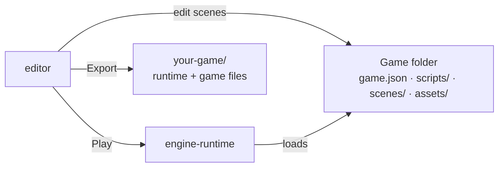

# Engine

A 2D multiplayer game engine written in C++20, with an **editor** to make
games and a **runtime** to play and ship them. Games are written in Lua and
laid out in scenes; nothing is compiled to make one. Every game is networked
from the start: up to four players on an authoritative server over UDP.



The repository ships one example, [R-Type](examples/r-type.md): a cooperative
shoot'em up made only of Lua scripts, scenes and assets.

## Where to start

| I want to... | Read |
|---|---|
| Build the editor and open the example | [Getting started](getting-started.md) |
| Learn the editor | [The editor](guide/editor-tour.md) |
| Make a game from scratch | [Your first game](guide/first-game.md) |
| Know every Lua function | [Lua API reference](reference/lua-api.md) |
| Organise a bigger game | [Scripting a game](guide/scripting.md) |
| Run a game, host it, ship it | [Run and export](guide/run-and-export.md) |
| See a complete game | [R-Type example](examples/r-type.md) |
| Work on the engine or the editor | [Architecture](architecture.md), [Engine modules](engine.md), [Editor internals](editor-app.md) |
| Write a client in another language | [Protocol](protocol.md) |
| Open a pull request | [Contributing](contributing.md) and [Commands](commands.md) |

## Quick start

```sh
export VCPKG_ROOT=~/vcpkg
cmake --preset release && cmake --build --preset release
./build/release/bin/editor examples/r-type      # then press Play
```

## Project status

| Piece | State |
|---|---|
| Engine | ECS, fixed-step loop, physics, pathfinding, Lua runtime, UDP networking with replication, Raylib graphics and audio plugins |
| Runtime | Solo, host, join and dedicated server modes for any game folder |
| Editor | Scenes, viewport (place, move, scale, rotate), inspector with prefab overrides, undo/redo, Play, Export, command palette, settings |
| Next | A launcher to create and open games, scene management buttons, an asset browser, script hot reload, a second example game |

The API reference generated by Doxygen from the public headers is published at
[saitamadupauvre.github.io/RType/api](https://saitamadupauvre.github.io/RType/api/).
