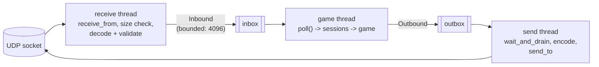
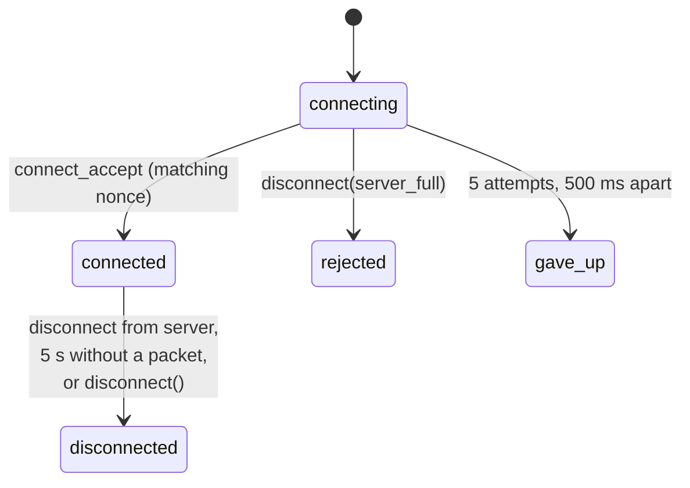

# Networking internals

How `engine-network` is built: threads, queues, sessions, replication, and
what happens when something goes wrong. The wire format itself is specified
in the [protocol](protocol.md).

Everything here is generic: the module knows players, entities with a type
id, inputs made of action bits and two axes, but nothing about R-Type.

## Public API

| Header | Type | Used by |
|---|---|---|
| `engine/network/Server.hpp` | `NetworkServer`, `ServerOptions`, `PlayerInput` | `r-type_server` |
| `engine/network/Client.hpp` | `NetworkClient`, `EntitySnapshot`, `ConnectionState` | `r-type_client` |
| `engine/network/Replicated.hpp` | `Replicated { type_id, owner }` | Marks the entities sent in snapshots |
| `engine/network/Events.hpp` | `PlayerJoined`, `PlayerLeft`, `Disconnected`, `EntitySpawned`... | Published on the `EventBus` |
| `engine/network/Stats.hpp` | `NetworkStats`, `PlayerStats` | Traffic statistics |

Both classes are pimpl wrappers: sockets and protocol types never appear in
public headers.

```cpp
engine::network::NetworkServer server(clock, events, {.port = 4242, .max_players = 4, .types = types});
server.start(ec);                    // binds 0.0.0.0:4242, starts the threads
// every tick:
server.receive();                    // sessions, timeouts, inputs
for (auto& input : server.inputs()) { /* apply */ }
server.send_snapshot(registry);      // queues snapshots for every session
```

## Layers inside the module

```
engine/src/network/
├── socket/      UdpSocket (RAII, POSIX), SocketError (engine error codes)
├── bytes/       ByteReader / ByteWriter: bounds-checked big-endian I/O
├── protocol/    header, messages, validation, ProtocolHandler, TypeTable, Sequence
├── encoder/     one encode_payload() per message
├── decoder/     one decode_<message>() per message, event reader table
├── thread/      MessageQueue, DatagramHandler, NetworkIo
├── session/     ServerSessions, ClientConnection
├── snapshot/    SnapshotBuilder (server), SnapshotReceiver (client)
├── event/       public events <-> protocol events
├── stats/       TrafficMeter
├── server/      ServerNetwork: one server tick of networking, without sockets
├── Server.cpp   NetworkServer = NetworkIo + ServerNetwork
└── Client.cpp   NetworkClient = NetworkIo + ClientConnection + SnapshotReceiver
```

Everything above `thread/` is plain functions and classes on decoded
messages: they take an `Inbound`, return `Outbound`s, read time from an
injected `IClock`, and never touch a socket. That is what makes them testable
without a network.

## Threads and queues

`NetworkIo` (`thread/NetworkIo.hpp`) owns the socket and two threads:



| Thread | Does | Never does |
|---|---|---|
| Receive | Blocks on `receive_from`, drops datagrams above 1200 bytes, decodes and validates, pushes valid messages into the inbox | Touch game state, write to the socket |
| Game (server) / main (client) | Drains the inbox with `poll()`, runs sessions and the game, pushes replies with `send()` | Block on the socket or wait for a client |
| Send | Sleeps on a condition variable until the outbox has messages, encodes and sends them | Read from the socket |

`MessageQueue<T>` is a mutex-protected vector. `drain()` swaps the buffer with
an empty one, so the consumer holds the lock only for the swap. The inbox is
**bounded** (4096 messages): if the game thread falls behind, extra messages
are dropped and logged instead of growing memory without limit.

Shutdown (`stop()`, also called by the destructor) is ordered so nothing is
lost or left hanging:

1. stop and join the send thread, which first flushes the outbox;
2. close the socket, which wakes the receive thread with `canceled`;
3. stop and join the receive thread.

The tests run the whole module under ThreadSanitizer (`cmake --workflow
--preset tsan`).

## Server side

### Sessions

`ServerSessions` (`session/ServerSessions.hpp`) maps each client endpoint to a
session: player id (lowest free, 1 to `max_players`), last time seen, latest
input and its sequence, packet sequence counter.

| Message from | Result |
|---|---|
| New endpoint, `connect_request`, slot free | Session created, `connect_accept` with player id and type table, `PlayerJoined` published |
| New endpoint, `connect_request`, server full | `disconnect(server_full)`, no session |
| Known endpoint, `connect_request` | Same `connect_accept` again (idempotent) |
| Known endpoint, `input` | Stored if its sequence is newer than the last accepted one; older or duplicated inputs are ignored |
| Known endpoint, `heartbeat` | Answered with a heartbeat (round-trip measurement) |
| Known endpoint, `disconnect` | Session ended |
| Unknown endpoint, anything else | Ignored, logged at debug level |

Any valid packet refreshes the session. `drop_timed_out()` ends sessions silent
for more than **5 seconds** and sends them `disconnect(timeout)`. Ending a
session, for any reason, frees the player id, sends a `player_left` event to
every remaining session and publishes `PlayerLeft` on the event bus, which
`ServerApp` forwards to Lua `on_player_left`.

### Replication

Each tick, `send_snapshot(registry)` builds snapshots from every entity with
`Replicated` and `Position` (plus `Velocity` and `Sprite` colour when present),
split into packets of at most 62 entities that share the same server tick, and
queues them for every session. Game events published on the bus during the
tick (`EntitySpawned`, `EntityDestroyed`, `ShotFired`, `SoundPlayed`, `MusicChanged`) are sent
before the snapshot, in order, to the sessions connected when they happened.

`ServerApp` decides what is replicated: every scripted entity with a sprite or
a colour gets `Replicated { type_id, owner }`; the type table is built from
the Lua declarations and sent in `connect_accept`, with the sound and music
tables built from `sounds { ... }` / `musics { ... }`. After each tick it turns
the scripts' `play` / `music` requests into `SoundPlayed` / `MusicChanged`.
The server remembers the last music so `connect_accept` gives it to players
joining later; the client publishes it as a `MusicChanged` on accept.

## Client side

`ClientConnection` (`session/ClientConnection.hpp`) runs the handshake:



Once connected it sends a heartbeat every second and the input every tick.
When the connection ends, the network threads stop and `Disconnected { reason }`
is published once on the client's event bus.

`SnapshotReceiver` keeps the world of the newest server tick: a newer tick
replaces it, packets of the same tick are merged by entity id, older ticks are
ignored (with wrap-around). `NetworkClient::entities()` returns that world in
world units.

## Failure handling

| Failure | Detected by | Handling |
|---|---|---|
| Datagram larger than 1200 bytes | Receive thread | Dropped and logged; never truncated |
| Truncated packet, bad magic or version, unknown type, wrong length | `ProtocolHandler::decode` on the receive thread | Dropped and logged with the sender and size |
| Payload with out-of-range values (axis 2, reserved bits, undefined reason) | Payload decoders, `is_valid` | Dropped and logged |
| Packet claiming a huge count (e.g. 65535 entities) | Decoder checks the remaining size **before** allocating | Dropped, no allocation |
| Snapshot or event before `connect_accept`, or with an unknown type id | `TypeTable` on the client | Dropped and logged |
| Packet from an unknown endpoint | `ServerSessions` | Ignored |
| Duplicated or reordered input | Sequence comparison with wrap-around | Ignored, still refreshes the session |
| Client crash or network cut | No packet for 5 s | Session ended, other players get `player_left`, their ship is removed by Lua |
| Server crash or network cut | No packet for 5 s on the client | Connection ended, `Disconnected { timeout }` |
| Server full | `ServerSessions` | `disconnect(server_full)`, client state `rejected` |
| Server shutdown (`Ctrl+C`) | `NetworkServer::stop()` | `disconnect(server_shutdown)` to everyone, outbox flushed |
| Game thread too slow | Inbox full | Extra messages dropped and logged, memory stays bounded |
| Socket error | `UdpSocket`, mapped to `SocketError` | Logged; the threads keep running |
| Lua error in a callback | `ScriptRuntime` (protected calls) | Logged with file and line; the game continues |

Each row has GoogleTest coverage under `tests/engine/network/` and
`tests/engine/script/`.

## Statistics

`TrafficMeter` counts packets and bytes per second over one-second windows,
loss (sequence gaps), reordering and the latest round-trip time.
`NetworkServer::stats()` (per player) and `NetworkClient::stats()` expose it,
and both log a summary every 10 seconds.

## Known limits

| Limit | Tracked in |
|---|---|
| Events and `player_left` are sent once, without acknowledgement | #86 |
| No client-side prediction or interpolation: the client shows the latest snapshot | #88 |
| POSIX sockets only, no Windows implementation | [Comparative study](comparative-study.md#cross-platform-support) |
| Full snapshot every tick, no delta compression | Part 2 |
